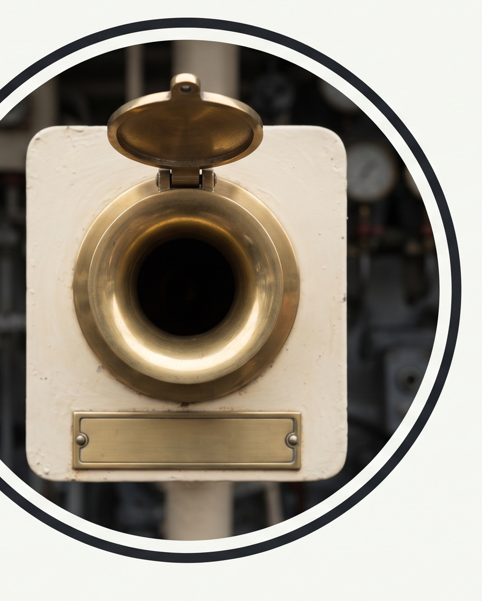
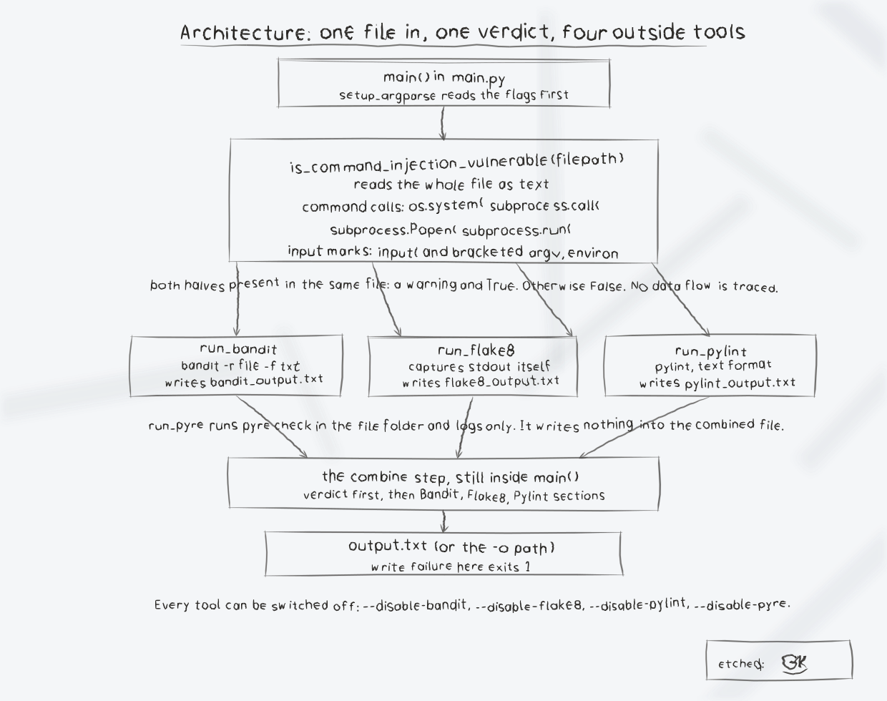

# codeintel-os-command-injection-checker

Title block: the name above is set in Benne in pencil dark upon a field khaki plate ruled as a specimen label, with the single sheet mark below beside this first heading only. Headings after the first keep the label treatment without the image, each set like a specimen label, with the hand lens that belongs upon the cabinet top.




# OS Command Injection Checker

Checks a single Python file for a potential OS command injection pattern, then optionally runs external analysis tools on the same file and combines their output into one results file.

The built in check is a plain substring search. It reports a potential vulnerability when the file contains one of `os.system(`, `subprocess.call(`, `subprocess.Popen(` or `subprocess.run(` and also contains one of `input(`, `sys.argv[` or `os.environ[` anywhere in the file. It does no data flow analysis, so it can miss real vulnerabilities and can flag code where the input never reaches the command.

> **Identification slip tucked beneath the sheet: the check traces no flow.** The built in check holds the whole file as one string and tests for the presence of spellings within it. A file in which input is gathered in one function and a command is run with a constant string in another function entirely is flagged exactly as a file in which the input is passed straight into the command is flagged.


## Requirements


- Python 3 (main.py uses only the standard library; `pip install -r requirements.txt` succeeds and installs nothing)
- Optional external tools, installed separately, for the parts that invoke them: Bandit, Flake8, Pylint and Pyre, for example `pip install bandit flake8 pylint pyre-check`. Any of them can be skipped with its disable flag.


## Install


```
git clone https://github.com/ShadowGuard-AI/codeintel-os-command-injection-checker.git
cd codeintel-os-command-injection-checker
```


## Usage


```
python main.py <filepath> [-o OUTPUT] [--disable-bandit] [--disable-flake8] [--disable-pylint] [--disable-pyre]
python main.py --help
```

- `filepath` (required, positional): path to the Python file to analyze. The program exits with status 1 if the file does not exist.
- `--output`, `-o`: combined results file. Default `output.txt`.
- `--disable-bandit`: do not run Bandit.
- `--disable-flake8`: do not run Flake8.
- `--disable-pylint`: do not run Pylint.
- `--disable-pyre`: do not run Pyre.

There is no `--version` flag.


## Examples


```
python main.py my_script.py
python main.py my_script.py --disable-bandit
python main.py my_script.py -o results.txt
python main.py my_script.py --disable-bandit --disable-flake8 --disable-pylint --disable-pyre
```

Verified output on a sample file that passes `input()` to `os.system`: the program prints `Potential OS command injection vulnerability detected in bad.py`, and `results.txt` begins with that verdict under a `Command Injection Check:` heading, followed by Bandit, Flake8 and Pylint sections. A file with no matching pattern prints `No immediate OS command injection vulnerability detected in <file>`.


## Output and limitations


- The combined output file contains the command injection verdict first, then whichever of `bandit_output.txt`, `flake8_output.txt` and `pylint_output.txt` were produced in the current directory during this run. Intermediate files from earlier runs are deleted at the start of each run so stale reports cannot leak into new results.
- Pyre output is logged only and is not written into the combined file. Pyre needs a configured Pyre project for the directory containing the target file; without one it reports that in the log.
- A tool that is not installed logs an error such as `Error running Bandit: [Errno 2] No such file or directory: 'bandit'` and the run continues. A missing tool by itself does not change the exit status: a clean built in verdict still exits with status 0. Bandit, Flake8 and Pylint findings do not change the exit status. The built in verdict does: a potential OS command injection vulnerability exits with status 1.
- The built in check only recognises the call and input spellings listed above. Calls such as `os.popen(`, `subprocess.getoutput(` or `eval(` are not detected by it, although Bandit may report some of them.

> **Identification slip: spellings the check does not recognise.** Calls such as `os.popen(`, `subprocess.getoutput(`, or `eval(` are not recognised by the built in check at all, although Bandit may report some of them.

> **Identification slip: the verdict alone sets the exit status.** A missing tool leaves the exit status untouched, and so do the findings of Bandit, Flake8, and Pylint. A potential vulnerability verdict sets the status to 1, and a clean verdict sets it to 0.


## License


Copyright (c) ShadowStrikeHQ. No separate LICENSE file is included in this repository.

> **Identification slip: the licence label disagrees with the repository.** The closing line above names ShadowStrikeHQ in place of ShadowGuard-AI, and claims that no separate LICENSE file is included. A LICENSE file is present in this repository and carries the MIT License. Both statements stand as printed, flagged here and repaired nowhere.


## Diagrams and maps


I drew the system out in [codeintel-os-command-injection-checker-Visuals](codeintel-os-command-injection-checker-Visuals/): an architecture diagram, a components diagram of the seven functions, a flowchart of one run, and a product map, with the written product map, statistics with citations, and the roadmap in [VISUAL.md](codeintel-os-command-injection-checker-Visuals/VISUAL.md). Every sheet also ships as a PNG photograph of the paper page beside its SVG.


